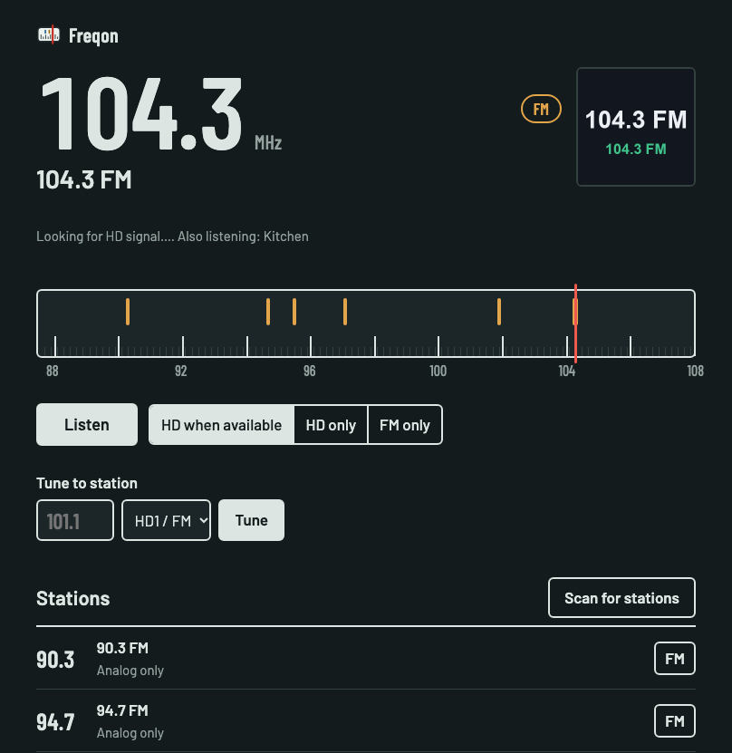

<picture>
  <source media="(prefers-color-scheme: dark)" srcset="docs/brand/freqon-logo-dark.png">
  
</picture>

**Freqon** turns an RTL-SDR dongle and a Raspberry Pi (or any Linux or macOS box) into a
network HD Radio and FM tuner that every app in the house can listen to and control:
its own web player, Plex Live TV and Jellyfin.

Freqon works with inexpensive USB devices.  The RTL-SDR tuners.  I bought mine from
[Aliexpress for $20](https://s.click.aliexpress.com/e/_c3GmTmhZ).



- Plays **HD Radio (digital) when it's available and falls back to analog FM** when it
  isn't, without a gap. Analog starts within about a second of tuning; HD takes over
  a few seconds later once it has locked.
- Clients can force **HD only** or **FM only**.
- **Shared tuners.** One dongle plays every HD channel of a station at once (97.1 HD1 for
  you, HD2 for someone else); each extra dongle adds a station. When every tuner is in
  use, asking for another station gets a "busy" answer naming who has what, with the
  option to take over the tuner that was tuned longest ago.
- **Scans** the FM band and keeps a station list, including each station's HD channels
  (HD1, HD2, …). You can rename or hide stations. It also rescans quietly on a tuner nobody
  is using (hourly while the radio is in use, every 30 days otherwise) and adds new stations
  and HD channels. It never removes any, and stops at once if someone wants that tuner.
- Shows the station name and **what's playing** (song title / artist) from the HD signal,
  plus what else the station broadcasts: **album art**, the station's own **logos**,
  **emergency alerts** (a red banner in every player and in the video), **traffic and
  weather maps**, the transmitter's location and audio details.
- Looks after the dongle: picks dongles by **serial number**, **calibrates** its frequency
  error from HD stations, and recovers when it stalls or disappears (USB reset on Linux,
  then a restart).

Built on [nrsc5](https://github.com/theori-io/nrsc5) for HD Radio decoding.

## How it works

```
RTL-SDR ──► nrsc5 ──► HD audio + station info ───────────┐
              │                                           ▼
              └──► raw I/Q ──► analog FM demod ──► mixer (HD preferred, crossfade)
                                                          │ 44.1 kHz PCM
                                ┌─────────────────────────┤
                                ▼                         ▼
                      MP3 encoder (ffmpeg)      MPEG-TS + "now playing" video (ffmpeg)
                      web player                Jellyfin / Plex / xTeVe
```

nrsc5 owns the dongle and hands every raw sample buffer to the analog demodulator too,
so both decoders run off one tuner. Encoders start on demand and are shared by all
listeners.

## Running it

Get the code, then run the installer for your system. Every installer builds nrsc5,
installs Freqon, and starts it on port 8080 now and whenever the machine (or, on
macOS/Windows, your account) starts. It restarts by itself if the dongle stalls.

```sh
git clone https://github.com/kireol/freqon.git && cd freqon
```

| System | Install | Settings | Logs |
|---|---|---|---|
| Raspberry Pi OS | `sudo ./deploy/install-pi.sh` | `/etc/freqon/config.toml` | `journalctl -u freqon -f` |
| Linux (Debian, Ubuntu, Fedora, Arch) | `sudo ./deploy/install-linux.sh` | `/etc/freqon/config.toml` | `journalctl -u freqon -f` |
| macOS (needs [Homebrew](https://brew.sh)) | `./deploy/install-mac.sh` | `~/.config/freqon/config.toml` | `~/Library/Logs/Freqon/freqon.log` |
| Windows 10/11 \*untested | double-click `deploy\install-windows.cmd` | `%USERPROFILE%\.config\freqon\config.toml` | `%LOCALAPPDATA%\Freqon\freqon.log` |

All settings are optional; `deploy/config.example.toml` lists them. After changing them,
restart Freqon: `sudo systemctl restart freqon` on Linux, `launchctl kickstart -k
gui/$(id -u)/org.freqon.server` on macOS, sign out and in (or restart the "Freqon" task in
Task Scheduler) on Windows.

**Sign-in (optional):** with no settings, anyone on your network can use the web player.
To require a username and password, set `web_username` and `web_password` in the config
(or start Freqon with `--web-username radio` and the password in `FREQON_WEB_PASSWORD`).
It covers the web player and its controls; Plex and Jellyfin keep working without it.

Notes per system:

- **Raspberry Pi:** a Pi 3 is enough for one tuner. See [Raspberry Pi 3 performance](#raspberry-pi-3-performance)
  for what each part costs.
- **Linux:** runs as a `freqon` system user, which a udev rule lets open RTL-SDR dongles.
  Stock Fedora's ffmpeg has no H.264 encoder, so Plex/Jellyfin video needs RPM Fusion's
  ffmpeg (the installer warns). `--no-service` installs without starting it.
- **macOS:** runs as you, as a login item. The first time, macOS may ask whether Python can
  accept incoming connections: allow it, or Plex and Jellyfin can't reach it.
  `--uninstall` removes the login item.
- **Windows (\*untested):** this installer hasn't been run on a real Windows PC yet;
  reports of how it goes are welcome. It needs winget ("App Installer", included in current Windows). The installer
  adds Python, ffmpeg and MSYS2, builds nrsc5 (the first time takes a while), and opens
  port 8080 to private networks. Windows also needs the **WinUSB driver** for the dongle,
  once: plug it in, run [Zadig](https://zadig.akeo.ie), choose *Options → List All
  Devices*, pick *Bulk-In, Interface (Interface 0)*, select WinUSB and *Replace Driver*.
  Freqon starts when the user who installed it signs in. `-Uninstall` removes it again.

### Raspberry Pi 3 performance

Measured on a Pi 3 Model B (64-bit Pi OS), one tuner, one listener. Percentages are of one
of the Pi's four cores.

| Part | CPU | Notes |
|---|---|---|
| nrsc5 (HD Radio decoder) | ~60% | Runs whenever the tuner is in use, on HD and analog stations alike |
| Analog FM demodulator | ~35% | Freqon's own DSP thread |
| MP3 encoder (web player) | ~8% | One per channel being listened to, shared by its listeners |
| Plex/Jellyfin video, card only | small | A still "now playing" card at 2 frames/s |
| Plex/Jellyfin video, camera | ~105% | Camera decode ~75% plus the hardware encoder ~30% (640x360, 10 frames/s, 1536x432 camera sub stream) |

Listening alone takes about one core in total. Watching with a camera adds about another
core, but only while someone is watching.

- **nrsc5 is built with two speed-ups** that the installers apply automatically:
  `-ffast-math`, about 30% faster with identical decoding (the audio differs by at most 1
  bit), and a patch (`deploy/nrsc5-copy-usb-buffers.patch`) that copies each USB buffer
  out of the dongle's uncached memory before reading it, which saves another third.
  Without them nrsc5 needs more than a whole core on a Pi 3. It then falls behind and
  drops samples: HD Radio hides the gaps, but **analog FM sounds choppy** and `htop` shows
  one core pegged. Installed before these changes? Run the installer again; it rebuilds
  nrsc5 and keeps your settings.
- **Cameras:** use the camera's low-resolution sub stream, not the main one. Decoding is
  the expensive part, and high-resolution streams (4K and up) are more than a Pi 3 can
  decode in real time. Wide cameras are letterboxed, never cropped.
- **Hardware video encoder** (`video_encoder = "h264_v4l2m2m"`): the service user has to
  be in the `video` group. The installer does this; without it the video stream fails
  with "Permission denied".
- **Extra tuners** each add another nrsc5 and demodulator (about another core). Two on a
  Pi 3 should fit without camera video, but that hasn't been tested; a Pi 4/5 or a PC
  has more room.

### Development

Needs Python 3.11+, [uv](https://docs.astral.sh/uv/), ffmpeg, and a built nrsc5.

```sh
uv sync
uv run python -m freqon --nrsc5-lib ../nrsc5/build/src/libnrsc5.dylib
uv run pytest
```

No dongle handy? `--iq-file recording.cu8` plays a raw recording (unsigned 8-bit I/Q at
1,488,375 samples/s, e.g. from `nrsc5 -w`) in a loop, and `--rtltcp host:port` uses a
dongle on another machine.

## Using it

Open `http://<pi>:8080/`.

### Plex

Either:

- **Direct (simplest):** In Plex, *Settings → Live TV & DVR → Set up Plex DVR*, enter
  `<pi>:8080` as the device address. Freqon presents itself as an HDHomeRun with as
  many tuners as you have dongles.
  When Plex asks for a guide, choose the XMLTV option and give it
  `http://<pi>:8080/xmltv.xml`.
- **Through xTeVe:** add `http://<pi>:8080/playlist.m3u` as the M3U source and
  `http://<pi>:8080/xmltv.xml` as the XMLTV source.

**Video:** Plex needs a picture, so the stream carries a "now playing" card. Set
`video_source` in the config to a camera (RTSP, or a go2rtc stream such as
`rtsp://go2rtc.local:8554/camera`) and the picture becomes that camera with the station
and song burned in along the bottom. If the camera drops, the card is shown until it
comes back; the stream itself never stops. On a Pi 3 use `video_size = "640x360"`,
`video_fps = 10` and `video_encoder = "h264_v4l2m2m"`, and point `video_source` at the
camera's low-resolution sub stream (see [Raspberry Pi 3 performance](#raspberry-pi-3-performance)).

Each HD channel becomes a Plex channel numbered `<MHz×10>.<HD number>`, so 97.1 HD2
is channel `971.2`. Analog-only stations appear as `<MHz×10>.1`.

### Jellyfin

Dashboard → Live TV:

- **Tuner device:** type *M3U Tuner*, URL `http://<pi>:8080/playlist.m3u?client=jellyfin`,
  simultaneous stream limit = number of dongles.
- **TV guide data provider:** *XMLTV*, URL `http://<pi>:8080/xmltv.xml`.

Channels match their guide entries automatically. `?client=jellyfin` gives Jellyfin its own
identity, so the web player's busy list shows Jellyfin and Plex separately.

### API (for other apps)

Identify your client with `client_id`, `client_name` and `kind` (in the JSON body or the
query string). It's how the server tells your own listening apart from someone else's.

| Method | Path | What it does |
|---|---|---|
| GET | `/api/status` | Your channel: station, source (digital/analog/none), now playing, signal, `tuner`; plus `listeners`, `tuners` and scan progress |
| GET | `/api/events` | WebSocket; pushes `{"type":"status","status":{…}}` (your channel) whenever anything changes |
| POST | `/api/tune` | `{"frequency": 101.1, "program": 0}` or `{"channel": "971.2"}`; add `"override": true` to take over. **409** with `{"error":"busy","message":…,"holders":[…],"tuners":[…]}` if every tuner is in use |
| POST | `/api/mode` | `{"mode": "auto" \| "digital" \| "analog"}` for your channel (never needs an override) |
| POST / DELETE | `/api/scan` | Start / stop a band scan (busy rules apply) |
| GET | `/api/stations` | Station list with channels (`?all=1` includes hidden ones) |
| POST | `/api/stations` | `{"frequency": 101.1}`: add a station the scan missed (with its HD channels if you are tuned to it) |
| PATCH / DELETE | `/api/stations/{freq}` | `{"custom_name": "…", "hidden": true}` / remove |
| GET | `/stream.mp3` | Your channel's audio; keeps playing across your retunes (same connection) |
| GET | `/stream/{freq}/{program}.mp3` | Tune and listen in one request; **503** if busy (take over with `POST /api/tune`, then `/stream.mp3`) |
| GET | `/stream/{freq}/{program}.ts` | Tune and watch, as MPEG-TS with video, for Plex and Jellyfin. Takes over a tuner when all are in use |
| GET | `/card.png`, `/logo/{channel}.png` | Now-playing card; channel logos (the station's own when it has sent one) |
| GET | `/art/{channel}.jpg` | Album art the station is sending now (404 when none; status `art_key` changes with it) |
| GET | `/maps/traffic.png`, `/maps/weather.png` | Maps some stations broadcast (404 when none) |
| GET | `/playlist.m3u`, `/xmltv.xml` | For xTeVe / Plex XMLTV / Jellyfin. `/playlist.m3u?client=jellyfin` makes its streams identify as that app |
| GET | `/discover.json`, `/lineup.json`, `/lineup_status.json` | HDHomeRun emulation for Plex |

`program` is 0-based (0 = HD1). Frequencies are in MHz.

## Behaviour details

- **Auto mode on HD2/HD3:** these have no analog version, so when the HD signal drops
  they go silent rather than switching to the HD1 analog audio.
- **Weak HD:** on a weak signal nrsc5 fills the gaps with silence. In Auto, Freqon
  switches HD1 to FM once HD has been weak for `hd_fallback_seconds` (default 1.5), and back
  once HD has been solid for `hd_return_seconds` (default 5). After `hd_max_fallbacks` (3)
  drops within `hd_fallback_window_seconds` (300) it stays on FM until you choose Auto or HD
  again, or change station. The web player says when this is happening.
- **Analog is mono.** Digital is stereo.
- **Idle:** a tuner is released after `idle_timeout` seconds (default 30) with
  nobody listening, and restarts on the next tune (or when you press play again).
- **Plex and Jellyfin always get the channel they ask for.** Choosing a channel at the TV
  takes a tuner even when all are in use, the same as a takeover from the web player.
  Set `allow_takeovers = false` to turn all takeovers off: then whoever has a tuner keeps
  it, and everyone else gets "busy" (the web player hides its "Take over" button).
- **Takeovers:** the tuner tuned longest ago is taken. Web players on it move to
  the new station, so you hear what the TV is playing; Plex/Jellyfin streams on it stop
  (rather than playing the wrong station under the old guide entry).
- **Several tuners:** list them as `[[tuners]]` in the config (see
  `deploy/config.example.toml`). Each needs its own dongle (or rtl_tcp server).
- **Host names:** the server answers to IP addresses, `localhost`, its own hostname and
  `<hostname>.local`. If you reach it by another DNS name, add that to `allowed_hosts` in
  the config. Unknown names get HTTP 421, which blocks DNS-rebinding attacks. Browser
  requests from other websites can't control the tuner (including through stream URLs).
  There is no password; anyone on your network can control it.

### Several dongles

`freqon --list-dongles` prints each dongle's index and serial number. Use `serial = "..."`
in a `[[tuners]]` entry so a dongle keeps its role when USB order changes.

## Not done yet

- Time shifting (pause / rewind live radio) in web - works in Jellyfin and Plex
- Stereo analog decoding

## License

GPL-3.0-or-later, because it includes `src/freqon/nrsc5.py` from nrsc5 (GPL-3.0).
